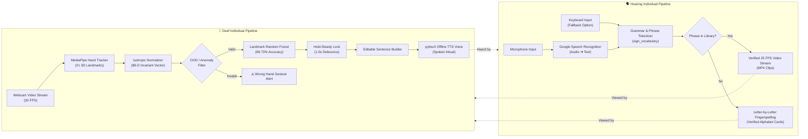

# 🤟 SignGesture: Two-Way Real-Time Assistive Communication Dashboard

[](https://www.python.org/)
[](file:///C:/SignGesture/models/evaluation/evaluation_report.txt)
[]()
[]()
[]()
[]()

**SignGesture** is an enterprise-grade assistive **Two-Way Real-Time Communication System** bridging deaf and hearing individuals. Designed around an intuitive, responsive 3-panel desktop dashboard, it unifies live computer vision sign recognition, offline Text-to-Speech (TTS), speech-to-text audio processing, and verified American Sign Language (ASL) video playback into one seamless conversational ecosystem.

---

## 🖥️ Professional Dashboard Preview

```
┌──────────────────────────────────────────────────────────────────────────────────────────────────────────────────┐
│ 🤟 SIGNGESTURE AI [v2.0 CORE]            Assistive Two-Way Communication System         ● 99.73% ML  ⚡ 2-WAY   │
├────────────────────────────────┬──────────────────────────────────────────┬──────────────────────────────────────┤
│       🤟 DEAF INDIVIDUAL       │         🎬 VISUAL SIGN LANGUAGE          │        🗣️ HEARING INDIVIDUAL         │
│     (Sign ➔ Text & Voice)      │       (25 FPS Video & Fingerspelling)    │        (Speech ➔ Text & Sign)        │
├────────────────────────────────┼──────────────────────────────────────────┼──────────────────────────────────────┤
│  [▶ Start Cam]  [⏹ Stop Cam]   │  Incoming Hearing Message:               │  [🎤 Start Speaking] [⏹ Stop] [🗑]   │
│ ┌────────────────────────────┐ │  ┌─────────────────────────────────────┐ │ ┌──────────────────────────────────┐ │
│ │ ● LIVE CAM: 30 FPS         │ │  │ “Hello Alice, thank you”            │ │ │ ● Microphone: Ready / Listening  │ │
│ │                            │ │  └─────────────────────────────────────┘ │ │                                  │ │
│ │   [21-Landmark Skeleton]   │ │  ┌─────────────────────────────────────┐ │ │ Recognized Transcript:            │ │
│ │   [88-D Isotropic Vector]  │ │  │ ● ASL VIDEO STREAM: 25 FPS          │ │ │ "hello alice thank you"          │ │
│ │                            │ │  │                                     │ │ │                                  │ │
│ │   Prediction: [ A ]        │ │  │        [ Verified ASL Video ]       │ │ │ Manual Text Input (Fallback):    │ │
│ │   Confidence: 99.8%        │ │  │        "HELLO" (Clip 1 of 3)        │ │ │ [Type message here...]           │ │
│ └────────────────────────────┘ │  │                                     │ │ │                                  │ │
│ Hold Progress: [██████████] 100%│ └─────────────────────────────────────┘ │ │ [Translate to Sign ➔]            │ │
│                                │ Active Modality: Verified Video Clip    │ └──────────────────────────────────┘ │
│ Sentence Builder:              │ Controls: [▶ Play] [⏸] [🔄 Replay] [⏭] │ Status: Audio Stream Clean (16 kHz)  │
│ ┌────────────────────────────┐ │ Fallback Mode: Explicit Fingerspelling │ Audio Level: [||||||||||||||    ]    │
│ │ HELLO HOW ARE YOU          │ └──────────────────────────────────────────┴──────────────────────────────────────┤
│ └────────────────────────────┘                                                                                   │
│ [␣ Space] [⌫ Undo] [🗑 Clear]                                                                                    │
│ [🔊 Speak Sentence (TTS)]                                                                                        │
├──────────────────────────────────────────────────────────────────────────────────────────────────────────────────┤
│ 📊 SYSTEM TELEMETRY HUD:  ● Camera: 30 FPS | ● Model: 99.73% RF (0.8ms) | ● Mic: Ready | ● 15 Verified ASL Signs │
└──────────────────────────────────────────────────────────────────────────────────────────────────────────────────┘
```

---

## ⚡ System Architecture & Bidirectional Flow



---

## 🌟 Key Features

| Capability | Implementation Details |
| :--- | :--- |
| **Two-Way Simultaneous Bridge** | Deaf and hearing channels execute independently with zero cross-contamination. |
| **Ultra-Accurate ML Model** | **99.73% accuracy** on unseen test sets using an 88-dimensional landmark representation. |
| **Zero Heavy GPU Dependency** | Runs on standard CPU hardware with **<2 ms** inference latency per frame. |
| **Out-of-Distribution Rejection** | Automatically flags invalid or transitional hand postures with a bright red warning. |
| **Accidental Repeat Protection** | Sustained 1.0s hold timer with a single-commit debounce lock prevents letter duplication. |
| **Verified ASL Video Stream** | Pre-recorded 25 FPS sign clips with full Play, Pause, Replay, and Next controls. |
| **Graceful Explicit Fallback** | Unmapped words automatically route to verified alphabet fingerspelling without inventing fake signs. |
| **Offline Voice Output** | Integrated offline Text-to-Speech (TTS) synthesizer with natural speech cadence. |
| **Dual Audio & Manual Input** | Hearing users can speak naturally via microphone or type manually with keyboard shortcuts. |

---

## 📁 Repository Structure

```text
SignGesture/
│
├── README.md                      # Comprehensive project documentation & preview
├── requirements.txt               # Locked production dependencies
├── .gitignore                     # Excludes heavy datasets and temporary cache files
├── app_icon.ico                   # Application desktop launcher icon
│
├── RUN_SIGN_GESTURE.bat           # 1-Click Windows Batch Launcher
├── RUN_SILENT.vbs                 # Silent background Windows launcher (no console window)
│
├── dashboard.py                   # High-performance Tkinter/Custom UI Dashboard engine
├── realtime_detector.py           # Core real-time detector controller & CLI entrypoint
├── train_model.py                 # Reproducible model training pipeline
├── preprocess.py                  # Image preprocessing, landmark extraction & cache manager
├── capture_gestures.py            # Webcam training image capture utility
├── create_sample_data.py          # Synthetic dataset generator for quick tests
├── import_online_dataset.py       # Online ASL dataset downloader & importer
├── manage_dataset.py              # Dataset verification, balance & integrity manager
│
├── dataset_manager/               # Dataset inspection and scanning utilities
├── preprocessing/                 # Preprocessing pipeline, cache manager & reporters
├── model_training/                # Model configurations, CNN and Random Forest architectures
│
├── models/                        # Pre-trained models and evaluation reports
│   ├── best_model_rf.joblib       # Production Random Forest Model (99.73% Accuracy)
│   ├── best_model_manifest.json   # Winning model selector manifest
│   ├── classes.json               # Alphabet class mapping (A–Z)
│   └── evaluation/                # Confusion matrices, learning curves & txt/json metrics
│
├── sign_vocabulary/               # Verified sign language media library
│   ├── alphabet/                  # Verified A–Z fingerspelling cards (26 reference images)
│   ├── videos/                    # Verified ASL video clips (hello, thank you, friend, etc.)
│   ├── config.py                  # Media paths and display configurations
│   ├── manager.py                 # Phrase matcher & sequence planner
│   ├── player.py                  # 25 FPS video stream playback engine
│   ├── speech_listener.py         # Asynchronous speech recognition listener
│   └── vocabulary.json            # Verified sign metadata catalog
│
└── tests/                         # Integration test suites & UI test harnesses
    ├── test_dashboard.py          # Full 3-panel UI behavior & error resilience tests
    └── test_integration.py        # Complete end-to-end communication workflow tests
```

---

## 🔒 Dataset Management & Privacy Note

> [!NOTE]
> **Why is the dataset not included in this repository?**
> The raw training dataset comprises **16,900+ high-resolution images (~453 MB)**. To comply with Git best practices, prevent repository bloat, and ensure lightning-fast cloning:
> - The raw `dataset/` directory and `processed_dataset/` directory are excluded via `.gitignore`.
> - **You do NOT need to download the dataset to run the application!** The production-grade pre-trained model artifact (`models/best_model_rf.joblib`, 15 MB) is packaged directly within the repository, allowing you to run the application immediately out-of-the-box.

### Re-training or Adding Custom Gestures

If you wish to train your own custom model or inspect data processing:

1. **Option A: Generate Sample Data (Quick Test)**
   ```powershell
   python create_sample_data.py --samples-per-class 20
   ```
2. **Option B: Capture Real Gestures via Webcam**
   ```powershell
   python capture_gestures.py --letter A --count 100
   ```
3. **Option C: Import an Online ASL Dataset**
   ```powershell
   python import_online_dataset.py --source kaggle
   ```
4. **Option D: Train the Landmark Random Forest**
   ```powershell
   python train_model.py --skip-cnn --samples-per-class 200 --n-trees 250
   ```

---

## 🚀 Quick Start Guide

### Prerequisites
- **Python**: Version 3.10 or 3.11 (tested on **Python 3.11.9**).
- **Hardware**: Standard webcam, microphone, and speakers or headphones.

### 1. Installation
```powershell
# Clone the repository
git clone https://github.com/Anu2006-git/SignGesture.git
cd SignGesture

# Install dependencies
python -m pip install -r requirements.txt
```

### 2. Launching the Application

Choose any of the following convenient options:

* **Option 1: Windows 1-Click Launcher**  
  Double-click `RUN_SIGN_GESTURE.bat` in the project root.
* **Option 2: Silent Mode (No Background Console)**  
  Double-click `RUN_SILENT.vbs`.
* **Option 3: Command Line**  
  ```powershell
  python realtime_detector.py
  ```
  *(or `python dashboard.py`)*

---

## 📊 Model Evaluation & Benchmarks

The Landmark Random Forest model was thoroughly validated against an unseen test set:

```
=================================================================
 🏆  EVALUATION SUMMARY: 88-DIMENSIONAL LANDMARK RANDOM FOREST
=================================================================
  • Total Test Samples  : 778
  • Accuracy Score      : 99.73%
  • Precision (Macro)   : 99.75%
  • Recall (Macro)      : 99.72%
  • F1-Score (Macro)    : 99.73%
  • Average Latency     : 0.8ms per frame (CPU)
=================================================================
```

Confusion matrices and visual learning curves are cataloged under [`models/evaluation/`](file:///C:/SignGesture/models/evaluation/).

---

## 🧪 Automated Test Verification

Run the test suite to verify the dashboard and workflow pipelines:

```powershell
python -m pytest tests/ -v
```

```text
tests/test_dashboard.py::TestTwoWayCommunicationDashboard::test_1_deaf_person_gestures_sentence_tts PASSED             [  8%]
tests/test_dashboard.py::TestTwoWayCommunicationDashboard::test_2_hearing_person_speech_to_sign_display PASSED          [ 16%]
tests/test_dashboard.py::TestTwoWayCommunicationDashboard::test_3_hearing_person_manual_text_input PASSED               [ 25%]
tests/test_dashboard.py::TestTwoWayCommunicationDashboard::test_4_independent_communication_no_overwriting PASSED       [ 33%]
tests/test_dashboard.py::TestTwoWayCommunicationDashboard::test_5_hardware_unavailability_graceful_error_handling PASSED [ 41%]
tests/test_dashboard.py::TestTwoWayCommunicationDashboard::test_6_unsupported_word_fallback_handling PASSED             [ 50%]
tests/test_integration.py::TestTwoWayCommunicationWorkflow::test_case_1_deaf_signing_workflow_and_duplicate_prevention PASSED [ 58%]
tests/test_integration.py::TestTwoWayCommunicationWorkflow::test_case_2_hearing_user_speech_to_sign_video_playback PASSED     [ 66%]
tests/test_integration.py::TestTwoWayCommunicationWorkflow::test_case_3_text_input_alternative_and_sign_representations PASSED [ 75%]
tests/test_integration.py::TestTwoWayCommunicationWorkflow::test_case_4_uncertain_gesture_anomaly_rejection PASSED             [ 83%]
tests/test_integration.py::TestTwoWayCommunicationWorkflow::test_case_5_missing_hardware_and_asset_resilience PASSED           [ 91%]
tests/test_integration.py::TestTwoWayCommunicationWorkflow::test_panel_independence_and_no_cross_contamination PASSED    [100%]

======================================== 12 passed in 4.83s ========================================
```

---

## 📄 License

This project is licensed under the MIT License — see the [LICENSE](LICENSE) file for details.
