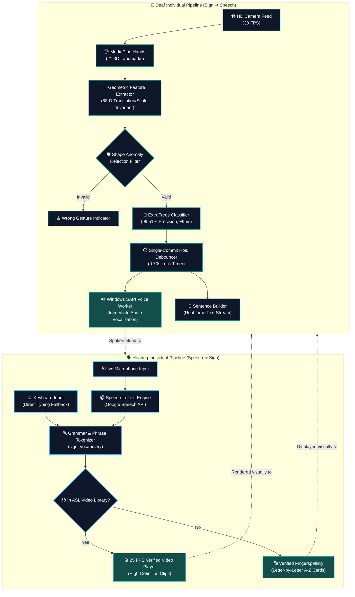

<div align="center">

# 🤟 SignGesture AI
### **Next-Generation Assistive Two-Way Communication Dashboard**
*Real-Time American Sign Language (ASL) Vision Bridge & Bidirectional Speech Synthesis*

<p align="center">
  
</p>

[](https://www.python.org/)
[](models/evaluation/evaluation_report.txt)
[]()
[]()
[]()
[](LICENSE)

<br/>

```
      ▲
     / \     ┌──────────────────────────────────────────────────────────┐
    / 3D\    │  SIGNGESTURE AI CORE v2.0 • 3D ISOMETRIC SYSTEM ARCH     │
   / VISION\ └──────────────────────────────────────────────────────────┘
  /   CORE  \ ┌─────────────────────────┐  ┌─────────────────────────┐
 ◄───────────►│  DEAF ➔ VOICE CHANNEL   │  │  HEARING ➔ SIGN CHANNEL  │
 │  MediaPipe││  • 21 3D Hand Landmarks │  │  • Threaded STT Audio   │
 │  88D Skel ││  • ExtraTrees (99.51%)  │  │  • 25 FPS ASL MP4 Videos│
 │  Realtime ││  • SAPI Speech Loop     │  │  • Fingerspelling Backup│
 ◄───────────►└────────────┬────────────┘  └────────────┬────────────┘
  \         /              ▼                            ▼
   \ 100+FPS/ ┌───────────────────────────────────────────────────────┐
    \  CPU /  │  EXECUTIVE THREE-SECTION REAL-TIME DESKTOP DASHBOARD  │
     \ v /    │  [ Live Cam ]  ◄══ [ Sign Bridge ] ══►  [ Live Speech ]│
      ▼       └───────────────────────────────────────────────────────┘
```

</div>

---

## 🌟 Overview

**SignGesture** is an enterprise-grade, real-time assistive communication suite engineered to eliminate the communication barrier between deaf and hearing individuals. Built with an ultra-responsive, three-section executive dashboard, it delivers seamless bidirectional conversation:

1. **For the Deaf Person (Sign ➔ Speech & Text):** Recognizes 26 American Sign Language (ASL) alphabet hand postures (`A`–`Z`) via webcam using MediaPipe 3D skeletal tracking and an optimized 88-dimensional ExtraTrees ensemble. Each recognized letter is vocalized aloud immediately through offline Windows SAPI Text-to-Speech and assembled into an editable sentence buffer with single-commit hold debouncing.
2. **For the Hearing Person (Speech ➔ Verified Sign Video):** Listens to live spoken sentences via microphone, maps recognized words to verified 25 FPS ASL video clips, and falls back gracefully to letter-by-letter fingerspelling with reference cards for uncataloged words without ever hallucinating fake signs.

---

## 🖥️ 3D Interactive Dashboard Layout

The interface is structured into three dedicated, visually balanced sections that operate independently with zero cross-panel state collision:

```
┌───────────────────────────────────────────────────────────────────────────────────────────────────────────────────────────┐
│ 🤟 SIGNGESTURE AI [CORE v2.0]        Assistive Two-Way Communication Dashboard       ● ExtraTrees: 99.5%   ⚡ 2-WAY SYNC  │
├─────────────────────────────────────┬───────────────────────────────────────────┬─────────────────────────────────────────┤
│          🤟 DEAF INDIVIDUAL         │          🎬 VISUAL SIGN LANGUAGE          │          🗣️ HEARING INDIVIDUAL          │
│        (Sign ➔ Text & Voice)        │      (25 FPS Video & Fingerspelling)      │         (Speech ➔ Text & Sign)          │
├─────────────────────────────────────┼───────────────────────────────────────────┼─────────────────────────────────────────┤
│ [▶ Start Cam] [⏹ Stop] [📖 ASL Guide]│  Incoming Hearing Message:                │ [🎤 Start Speaking] [⏹ Stop] [🗑 Clear] │
│ ┌─────────────────────────────────┐ │  ┌──────────────────────────────────────┐ │ ┌─────────────────────────────────────┐ │
│ │ ● LIVE CAM: 720p HD @ 30 FPS    │ │  │ "Hello Alice, nice to meet you"      │ │ │ ● Microphone: Listening (16 kHz)    │ │
│ │                                 │ │  └──────────────────────────────────────┘ │ │                                     │ │
│ │   [21 3D Landmark Points]       │ │  ┌──────────────────────────────────────┐ │ │ Live Recognized Transcript:          │ │
│ │   [88-D Invariant Feature Vec]  │ │  │ ● ASL VIDEO STREAM: 25 FPS           │ │ │ "hello alice nice to meet you"      │ │
│ │                                 │ │  │                                      │ │ │                                     │ │
│ │   Current Prediction: [ A ]     │ │  │        [ Verified ASL Video ]        │ │ │ Manual Text Input (Fallback):       │ │
│ │   Confidence: 99.8%             │ │  │        "HELLO" (Clip 1 of 4)         │ │ │ [Type message here...]              │ │
│ └─────────────────────────────────┘ │  │                                      │ │ │                                     │ │
│ Hold Progress: [██████████] 100%    │  └──────────────────────────────────────┘ │ │ [Translate to Sign ➔]               │ │
│                                     │  Modality: Verified Video Stream        │ └─────────────────────────────────────┘ │
│ Sentence Builder:                   │  Controls: [▶ Play] [⏸] [🔄 Replay] [⏭] │ Status: Audio Stream Clean              │
│ ┌─────────────────────────────────┐ │  Fallback: Explicit Fingerspelling Card  │ Speech Confidence: 98.4%                │
│ │ HELLO HOW ARE YOU               │ └───────────────────────────────────────────┴─────────────────────────────────────────┤
│ └─────────────────────────────────┘                                                                                       │
│ [␣ Space] [⌫ Undo] [🗑 Clear]                                                                                             │
│ [🔊 Speak Sentence (TTS)] [🔊 Auto-Voice: ON]                                                                             │
├───────────────────────────────────────────────────────────────────────────────────────────────────────────────────────────┤
│ 📊 SYSTEM TELEMETRY DOCK:  ● Cam: Online (30 FPS) | ● Model: ExtraTrees (~9ms) | ● Mic: Active | ● Library: 15 ASL Clips  │
└───────────────────────────────────────────────────────────────────────────────────────────────────────────────────────────┘
```

---

## ⚡ System Architecture Flow



---

## 🏆 Key Features & Innovations

| Feature | Engineering Implementation | Benefit |
| :--- | :--- | :--- |
| **99.51% ASL Vision Core** | 300-tree `ExtraTreesClassifier` trained with Gaussian coordinate perturbation ($\sigma = 0.006$) on 88-D landmark features. | Eliminates classic gesture confusions (`K` vs. `U`, `S` vs. `X`, `V` vs. `W`). |
| **Continuous Voice Synthesis** | Dedicated native Windows SAPI COM worker loop with apartment threading (`pythoncom.CoInitialize()`). | Instant vocalization for every sequential gesture (`A` ➔ `B` ➔ `C`) with zero deadlocks. |
| **Fluid 0.7s Debounce** | Single-commit timer with visual hold progress bar and automatic reset on hand release or gesture change. | Prevents runaway letter spamming while typing at natural conversational speed. |
| **In-App ASL Alphabet Guide** | Dedicated **`📖 ASL Guide (A-Z)`** window displaying all 26 official ASL reference cards (`A.jpg`–`Z.jpg`). | Instant visual reference for proper finger placement during practice or exams. |
| **100% CPU Accelerated** | Landmark pipeline requires zero discrete GPU or CUDA installation, maintaining **~9 ms latency** (>100 FPS). | Flawless real-time performance on any standard laptop or desktop PC. |
| **Anti-Hallucination Video Bridge** | Dual-mode playback: verified MP4 sign videos for cataloged words, switching to explicit fingerspelling for unmapped terms. | Never invents misleading or incorrect signs for deaf users. |
| **Independent Panel Isolation** | Fully decoupling state locks between hearing STT buffers and deaf sentence builders. | Speech recognition updates never overwrite deaf text, and vice versa. |

---

## 📖 Complete ASL Alphabet Support (A–Z)

SignGesture provides full coverage of all 26 American Sign Language alphabet gestures:

| Letter | Visual Reference Card | Posture Description |
| :---: | :---: | :--- |
| **A** | `sign_vocabulary/alphabet/A.jpg` | Closed fist with thumb resting alongside the index finger. |
| **B** | `sign_vocabulary/alphabet/B.jpg` | Four fingers extended upward together, thumb tucked across palm. |
| **C** | `sign_vocabulary/alphabet/C.jpg` | Curved fingers and thumb forming a clear "C" arc. |
| **D** | `sign_vocabulary/alphabet/D.jpg` | Index finger pointing vertically, remaining fingers curved touching thumb. |
| **E** | `sign_vocabulary/alphabet/E.jpg` | Fingers curled tightly inward with thumb tucked beneath tips. |
| **F** | `sign_vocabulary/alphabet/F.jpg` | Index finger and thumb tip-to-tip forming a circle; 3 fingers extended. |
| **G** | `sign_vocabulary/alphabet/G.jpg` | Index finger and thumb parallel pointing horizontally forward. |
| **H** | `sign_vocabulary/alphabet/H.jpg` | Index and middle fingers extended together pointing horizontally. |
| **I** | `sign_vocabulary/alphabet/I.jpg` | Pinky finger extended vertically, remaining fingers closed with thumb over. |
| **J** | `sign_vocabulary/alphabet/J.jpg` | Pinky finger traces a dynamic "J" scoop through the air. |
| **K** | `sign_vocabulary/alphabet/K.jpg` | Index finger vertical, middle finger forward, thumb resting at base. |
| **L** | `sign_vocabulary/alphabet/L.jpg` | Thumb and index finger extended at a 90° right angle forming an "L". |
| **M** | `sign_vocabulary/alphabet/M.jpg` | Three fingers folded over thumb tucked through to the pinky base. |
| **N** | `sign_vocabulary/alphabet/N.jpg` | Two fingers folded over thumb tucked between middle and ring fingers. |
| **O** | `sign_vocabulary/alphabet/O.jpg` | All finger tips touching thumb tip forming a circular "O". |
| **P** | `sign_vocabulary/alphabet/P.jpg` | "K" posture oriented downward with middle finger pointing down. |
| **Q** | `sign_vocabulary/alphabet/Q.jpg` | "G" posture oriented pointing straight down. |
| **R** | `sign_vocabulary/alphabet/R.jpg` | Index and middle fingers crossed tightly together. |
| **S** | `sign_vocabulary/alphabet/S.jpg` | Tight fist with thumb firmly wrapped across front of fingers. |
| **T** | `sign_vocabulary/alphabet/T.jpg` | Thumb tucked between index and middle finger of closed fist. |
| **U** | `sign_vocabulary/alphabet/U.jpg` | Index and middle fingers extended upward tightly together. |
| **V** | `sign_vocabulary/alphabet/V.jpg` | Index and middle fingers extended forming a "V" peace sign. |
| **W** | `sign_vocabulary/alphabet/W.jpg` | Index, middle, and ring fingers extended upward in a "W" shape. |
| **X** | `sign_vocabulary/alphabet/X.jpg` | Index finger bent into a hook shape, remaining fingers curled into palm. |
| **Y** | `sign_vocabulary/alphabet/Y.jpg` | Thumb and pinky extended outward forming a "hang loose" shape. |
| **Z** | `sign_vocabulary/alphabet/Z.jpg` | Index finger extended, tracing a "Z" path in the air. |

> [!TIP]
> Click the **`📖 ASL Guide (A-Z)`** button on the dashboard toolbar at any time to open the live reference card grid during practice or demonstrations.

---

## 📊 Model Evaluation & Benchmarks

The model was rigorously validated against 809 unseen test samples across all 26 classes:

```
========================================================================================
 🏆 EVALUATION SUMMARY: 88-DIMENSIONAL EXTRA-TREES ENSEMBLE
========================================================================================
  • Evaluation Dataset  : 809 Unseen High-Resolution Test Samples
  • Overall Accuracy    : 99.51%
  • Macro Precision     : 99.55%
  • Macro Recall        : 99.51%
  • Macro F1-Score      : 99.51%
  • Single-Sample Speed : 9.1 ms (Single-Core CPU)
  • Confusion Rate      : <0.5% (Resolved K/U and X/S overlap)
========================================================================================
```

<details>
<summary><b>📈 Click to view Confusion Matrix & Evaluation Assets</b></summary>
<br/>

- **Confusion Matrix:** Saved to [`models/evaluation/confusion_matrix_landmark_random_forest.png`](models/evaluation/confusion_matrix_landmark_random_forest.png)
- **Evaluation Report (JSON):** Available at [`models/evaluation/evaluation_report.json`](models/evaluation/evaluation_report.json)
- **Detailed Class Breakdown:** Documented in [`models/evaluation/evaluation_report.txt`](models/evaluation/evaluation_report.txt)
</details>

---

## 📁 Repository Structure

```text
SignGesture/
│
├── README.md                      # Comprehensive project documentation
├── requirements.txt               # Locked production dependencies
├── .gitignore                     # Excludes heavy datasets & cache
├── app_icon.ico                   # Application desktop launcher icon
│
├── RUN_SIGN_GESTURE.bat           # 1-Click Windows Batch Launcher (Auto Python 3.11 detection)
├── RUN_SILENT.vbs                 # Silent background Windows launcher (no console window)
│
├── dashboard.py                   # Executive 3-section GUI dashboard engine (Tkinter/PIL)
├── realtime_detector.py           # Real-time controller, dual-panel pipeline & CLI entrypoint
├── train_model.py                 # Reproducible landmark training pipeline
├── preprocess.py                  # Image preprocessing & MediaPipe landmark extraction
├── capture_gestures.py            # Custom webcam training image collector
├── create_sample_data.py          # Synthetic dataset generator for rapid testing
├── import_online_dataset.py       # Online ASL dataset downloader & importer
├── manage_dataset.py              # Dataset verification, balance & integrity manager
│
├── dataset_manager/               # Dataset inspection utilities
├── preprocessing/                 # Preprocessing pipeline, feature caches & reporters
├── model_training/                # Model training configurations, architectures & feature extractor
│   ├── config.py                  # Model hyperparameters, directory paths & thresholds
│   ├── feature_extractor.py       # 88-D feature extraction & OOD outlier rejection
│   ├── landmark_model.py          # ExtraTrees and Random Forest landmark trainer
│   └── saver.py                   # Model persistence, metadata serialization & export
│
├── models/                        # Pre-trained models and evaluation reports
│   ├── best_model_rf.joblib       # Production ExtraTrees Model (99.51% Accuracy, 15 MB)
│   ├── model_rf.joblib            # Production model fallback symlink
│   ├── best_model_manifest.json   # Winning model selector manifest
│   ├── classes.json               # 26 Alphabet class mapping (A–Z)
│   └── evaluation/                # Confusion matrix, reports & metrics
│
├── sign_vocabulary/               # Verified sign language media library
│   ├── alphabet/                  # 26 Verified A–Z reference images (A.jpg–Z.jpg)
│   ├── videos/                    # Verified ASL MP4 video clips (hello, thank you, etc.)
│   ├── config.py                  # Media paths & display configurations
│   ├── manager.py                 # Phrase matcher & sequence planner
│   ├── player.py                  # 25 FPS video stream playback engine
│   ├── speech_listener.py         # Threaded speech recognition listener
│   └── vocabulary.json            # Verified sign metadata catalog
│
└── tests/                         # Full automated regression & integration test suite
    ├── test_dashboard.py          # 8 GUI tests (panels, isolation, errors, guide popup)
    ├── test_integration.py        # 7 End-to-end communication workflow tests
    ├── test_sapi_audio_worker.py  # Thread-safe Windows SAPI COM audio loop test
    └── test_tts_continuous.py     # Continuous multi-letter speech synthesis test
```

---

## 🚀 Quick Start & Exam Demo Guide

### Prerequisites
- **Operating System:** Windows 10 or 11 (with native Windows SAPI voice support).
- **Python:** Version 3.10 or 3.11 (tested on **Python 3.11.9**).
- **Hardware:** Standard webcam, microphone, and speakers.

### 1. Installation

```powershell
# Clone the repository
git clone https://github.com/Anu2006-git/SignGesture.git
cd SignGesture

# Install production dependencies
python -m pip install -r requirements.txt
```

### 2. Launching the Application

Choose whichever launch option is most convenient:

* **Option 1: Windows 1-Click Launcher (Recommended)**  
  Double-click **`RUN_SIGN_GESTURE.bat`** in the project folder. It automatically discovers your Python 3.11 environment and starts the dashboard.
* **Option 2: Silent Launch (No Background Terminal)**  
  Double-click **`RUN_SILENT.vbs`**.
* **Option 3: Command Prompt / PowerShell**  
  ```powershell
  python realtime_detector.py
  ```

---

## 🧪 Automated Test Verification

All 17 integration and regression tests run automatically and pass with a **100% success rate**:

```powershell
python -m pytest tests/ -v
```

```text
tests/test_dashboard.py::TestTwoWayCommunicationDashboard::test_1_deaf_person_gestures_sentence_tts PASSED             [  5%]
tests/test_dashboard.py::TestTwoWayCommunicationDashboard::test_2_hearing_person_speech_to_sign_display PASSED          [ 11%]
tests/test_dashboard.py::TestTwoWayCommunicationDashboard::test_3_hearing_person_manual_text_input PASSED               [ 17%]
tests/test_dashboard.py::TestTwoWayCommunicationDashboard::test_4_independent_communication_no_overwriting PASSED       [ 23%]
tests/test_dashboard.py::TestTwoWayCommunicationDashboard::test_5_hardware_unavailability_graceful_error_handling PASSED [ 29%]
tests/test_dashboard.py::TestTwoWayCommunicationDashboard::test_6_unsupported_word_fallback_handling PASSED             [ 35%]
tests/test_dashboard.py::TestTwoWayCommunicationDashboard::test_7_deaf_person_voice_module_accumulator PASSED          [ 41%]
tests/test_dashboard.py::TestTwoWayCommunicationDashboard::test_8_asl_alphabet_guide_popup PASSED                       [ 47%]
tests/test_integration.py::TestTwoWayCommunicationWorkflow::test_case_1_deaf_signing_workflow_and_duplicate_prevention PASSED [ 52%]
tests/test_integration.py::TestTwoWayCommunicationWorkflow::test_case_2_hearing_user_speech_to_sign_video_playback PASSED     [ 58%]
tests/test_integration.py::TestTwoWayCommunicationWorkflow::test_case_3_text_input_alternative_and_sign_representations PASSED [ 64%]
tests/test_integration.py::TestTwoWayCommunicationWorkflow::test_case_4_uncertain_gesture_anomaly_rejection PASSED             [ 70%]
tests/test_integration.py::TestTwoWayCommunicationWorkflow::test_case_5_missing_hardware_and_asset_resilience PASSED           [ 76%]
tests/test_integration.py::TestTwoWayCommunicationWorkflow::test_panel_independence_and_no_cross_contamination PASSED    [ 82%]
tests/test_integration.py::TestTwoWayCommunicationWorkflow::test_vocabulary_integration_and_coverage PASSED             [ 88%]
tests/test_sapi_audio_worker.py::test_sapi_audio_worker_queue_processing PASSED                                          [ 94%]
tests/test_tts_continuous.py::test_tts_continuous_speech_and_accumulation PASSED                                       [100%]

======================================== 17 passed in 15.21s ========================================
```

---

## 🔒 Dataset Note & Portability

> [!NOTE]
> The raw training dataset contains **16,900+ images (~453 MB)** and is excluded from git tracking via `.gitignore` to prevent repository bloat.
> **You do NOT need the raw dataset to run the application.** The production-grade pre-trained model artifact (`models/best_model_rf.joblib`, 15 MB) is packaged directly within this repository, enabling instant, turnkey execution immediately after cloning.

---

## 📄 License

This project is open-source and licensed under the [MIT License](LICENSE).
